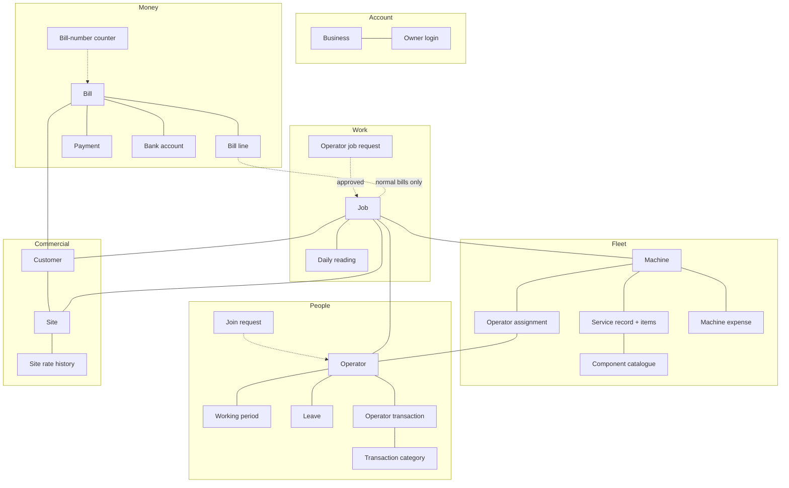

# 01 — Complete Module Map

## Scope

**Product audited:** `excavator-manager/`. This is the product's current version: its git working tree is clean, it has the latest commits, and it contains the Expenses module.

**The other folder:** the sibling folder `testing-excavator-demo/` is an older fork. Compared with the audited product it:
- has uncommitted changes;
- **lacks** the Expenses module, the diesel-price setting, the bill-template choice (Standard / Daily Summary), the "machines by site" view and the Direct-bill hours helper;
- **adds** a voice/text "assistant" that fills the same forms on the owner's behalf (`testing-excavator-demo/docs/assistant.md`).

That fork was not audited further.

**Channels:**
- the web app;
- an Android app that packages the same screens;
- a separate operator portal inside the same app.

**Users:**

| User | Access |
|---|---|
| **Owner** | The only business login. Full access to all business modules. |
| **Operator** | Separate portal. Can only record their own work, readings and diesel, and choose a language. |
| **Support** | Platform console. Cross-business oversight. |

## Module overview

| # | Module | Entry point (screen) | Business purpose | Users | Records managed | Requires | Generates for | Deep dive |
|---|---|---|---|---|---|---|---|---|
| 1 | **Account & Access** | `/register`, `/login`, `/forgot-password`, `/reset-password` | Open the business account; sign in | Public, Owner | Business, User | — | Every module (business scope) | D06 |
| 2 | **Home / Dashboard** | `/dashboard` (nav "Home") | Business snapshot and profit | Owner | — (read-only) | Bills, payments, work, expenses, services, salary | — | D05 F13, F14 |
| 3 | **Machines** | `/excavators` (nav "Machines"), `/excavators/new`, `/excavators/detail?id=` (tabs Work · History · Service · Details), `/excavators/detail/edit` | Fleet register and the machine's live state | Owner | Excavator, Operator assignment | — | Work, Service, Expenses, Bills, Reports | D01 |
| 3a | ↳ Operator assignment | Machine detail → Assigned operator card | Pair one operator with one machine | Owner | Operator assignment | Machine, Operator | Work (operator on job), Operator portal | D01 F8 |
| 3b | ↳ Current site | Machine detail → Site card | Where the machine is; close the old site | Owner | Excavator.currentSite, Site.status | Machine | Site Analysis, Start Work default | D01 F9 |
| 3c | ↳ Work (jobs & readings) | Machine detail → Work tab, History tab | Record jobs, daily readings, diesel | Owner | Job, Daily reading | Machine, Operator, Customer, Site | Billing, Reports | D02 |
| 3d | ↳ Service & maintenance | Machine detail → Service tab, `/excavators/detail/component` | Component-level servicing and due alerts | Owner | Service record, Service item | Machine | Alerts, Profit | D01 F11–F12 |
| 3e | ↳ Machine Performance | Machines page, bottom section | Earnings and hours per machine | Owner | — | Work engine, bills | — | D01 F13 |
| 4 | **Customers** | `/customers` (nav), `/customers/new`, `/customers/detail?id=`, `/customers/detail/edit` | Customer register, account and unbilled work | Owner | Customer | — | Jobs, Bills, Sites | D05 F1–F6 |
| 5 | **Operators** | `/operators` (nav), `/operators/new`, `/operators/detail?id=` (tabs Overview · Money · Salary · Sessions · History), `/operators/detail/edit` | Operator register, portal access, salary, advances, payments | Owner | Operator, Working period, Leave, Operator transaction, Transaction category | — | Machine assignment, Jobs, Profit | D03 |
| 6 | **Approvals** | `/operators/approvals` (nav "Approvals") | Review operator readings, operator jobs and join requests | Owner | Daily reading (status), Operator job request, Join request | Operator portal entries | Work, Operators | D02 F6, F14–F15, F17; D03 F6 |
| 7 | **Bills** | `/bills` (nav), `/bills/new`, `/bills/new/summary`, `/bills/new/direct`, `/bills/detail?id=`, `/bills/edit?id=` | Invoicing, payments, receivables, bill outputs | Owner | Bill, Bill line, Payment, Bill-number sequence | Customer, completed Jobs, Machine, Settings | Dashboard, Customers, Site Analysis, Profit | D04 |
| 7a | ↳ Payments | Bill detail → payment section | Record receipts against a bill | Owner | Payment | Bill | Bill status, Dashboard, Customers | D04 F11 |
| 8 | **Site Analysis** | `/site-analysis` (nav), `/site-analysis/detail?id=`, `/site-analysis/machine` | Sites, rates and site/machine/day reports | Owner | Site, Site rate history | Customers (optional), Work, Bills | Work valuation, Customers, Dashboard | D05 F7–F12 |
| 9 | **Diesel Checker** | `/diesel-checker` (nav) | Fuel-average calculator | Owner | none (nothing saved) | — | — | D02 F19 |
| 10 | **Expenses** | `/expenses` (nav) | Money spent per machine | Owner | Machine expense | Machine | Profit | D01 F14 |
| 11 | **Search** | `/search` (top bar) | Find machines, customers, operators, bill numbers | Owner | — | — | — | D05 F15 |
| 12 | **Settings** | `/settings` | Business profile, letterhead, banks, diesel price, operator language, business code, security | Owner | Business, Bank account, User security | — | Bills (letterhead, bank), Alerts, Profit, Operator portal | D05 F16 |
| 13 | **Operator Portal** | `/operator-login`, `/operator-signup`, `/operator` | Operator records work, readings and diesel; requests to join | Operator, Public (signup) | Operator job request, Daily reading (pending), Join request | Assignment to a machine | Approvals | D02 F4–F5, F11–F16; D03 F5 |
| 14 | **Support Console** | `/support` | Platform oversight: impersonate, freeze, limits, clear data | Support | Business flags, Audit log | — | All modules (freeze, limits) | D05 F17 |
| 15 | **Alerts (bell)** | Top bar on every owner screen | Pending approvals, active operator jobs, service due | Owner | — | Work, Service | — | D05 F14 |

## Submodule and record map

## Navigation (owner)

The navigation order, from `src/components/shell/nav-items.ts`:
1. Home
2. Machines
3. Customers
4. Operators
5. Bills
6. Approvals
7. Site Analysis
8. Diesel Checker
9. Expenses

Settings and Search are reached from the top bar.

## Routes inventory

The full list of every screen and every server action, with investigation status, is in **12_AUDIT_COVERAGE_CHECKLIST.md**.

**Note:** the repository's generated `docs/authorization-matrix.md` is out of date. It omits these routes:
- `/api/expenses` (GET, POST) and `/api/expenses/[id]` (DELETE)
- `/api/settings/diesel-price` (PATCH)
- `/api/settings/bill-template` (GET, PATCH)
- `/api/sites/fleet` (GET)
- `/api/bills/direct/hours` (GET)
