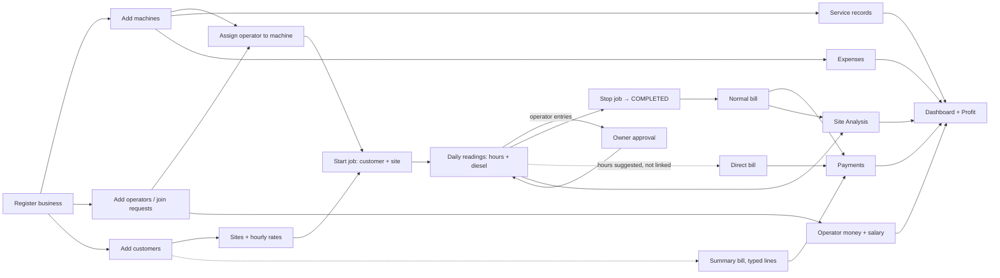
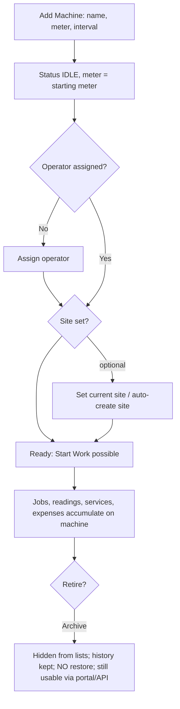
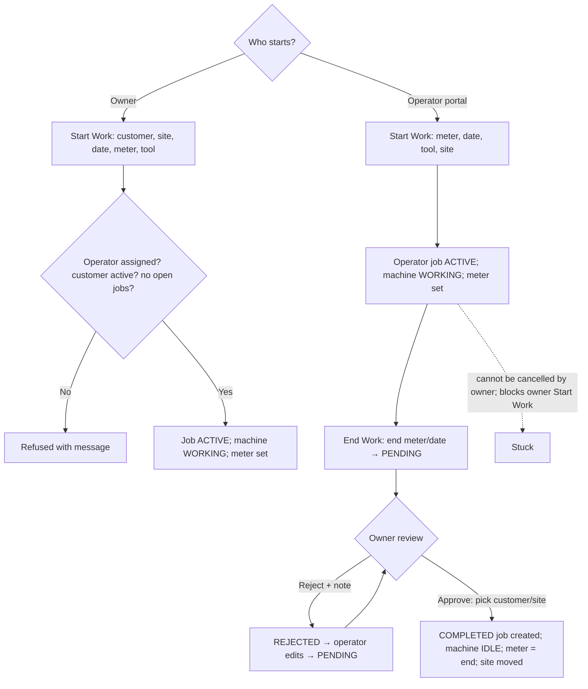
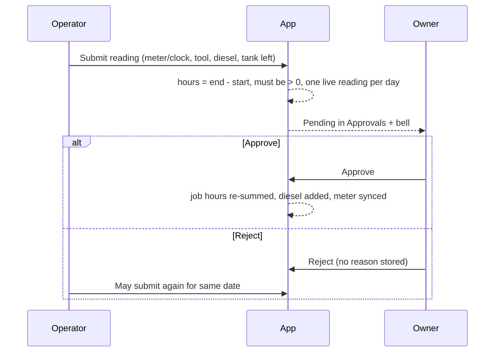
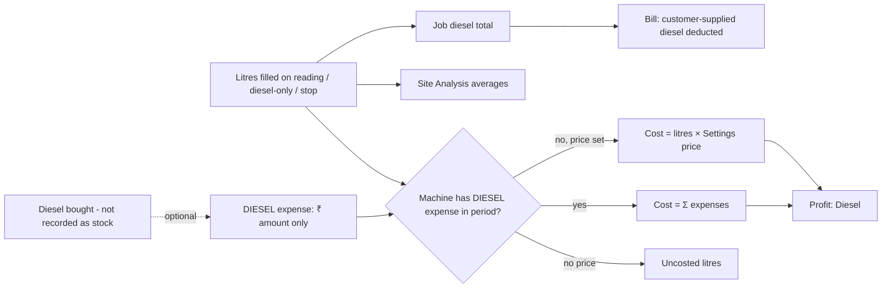
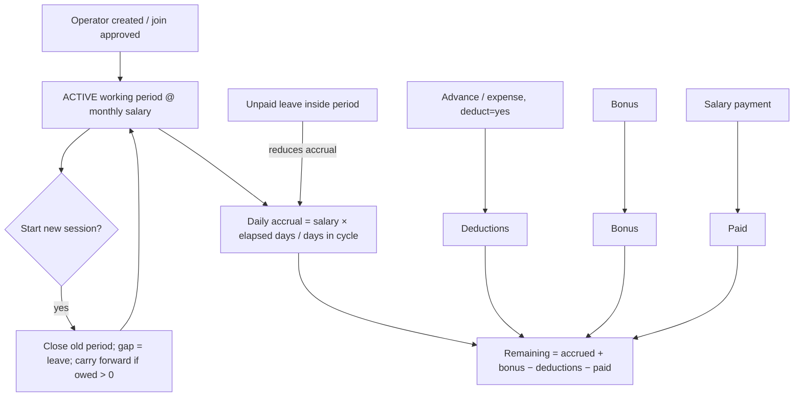
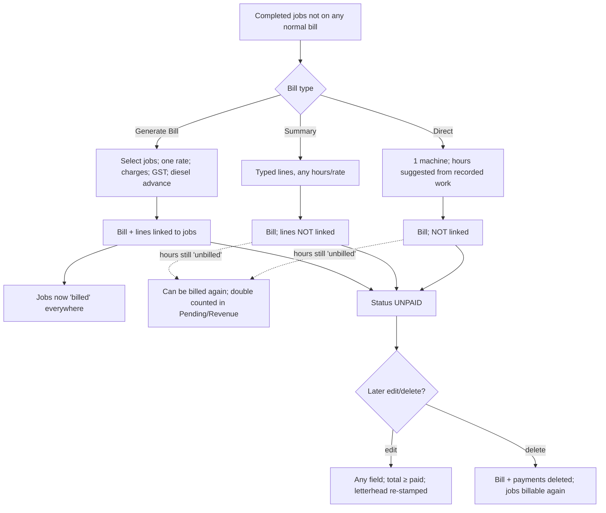
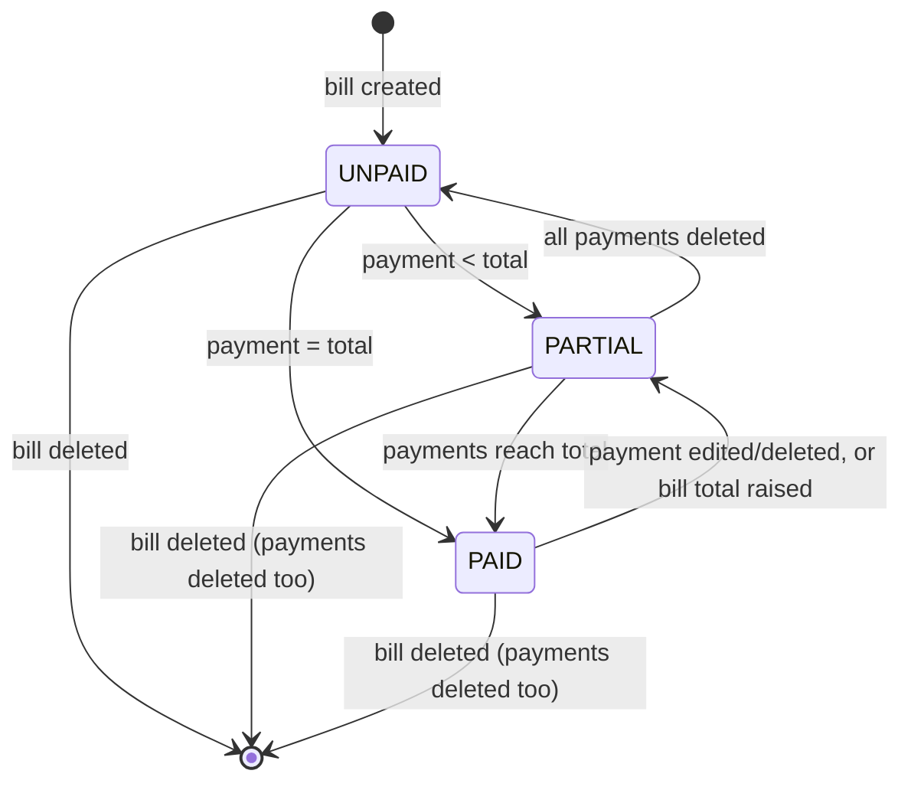
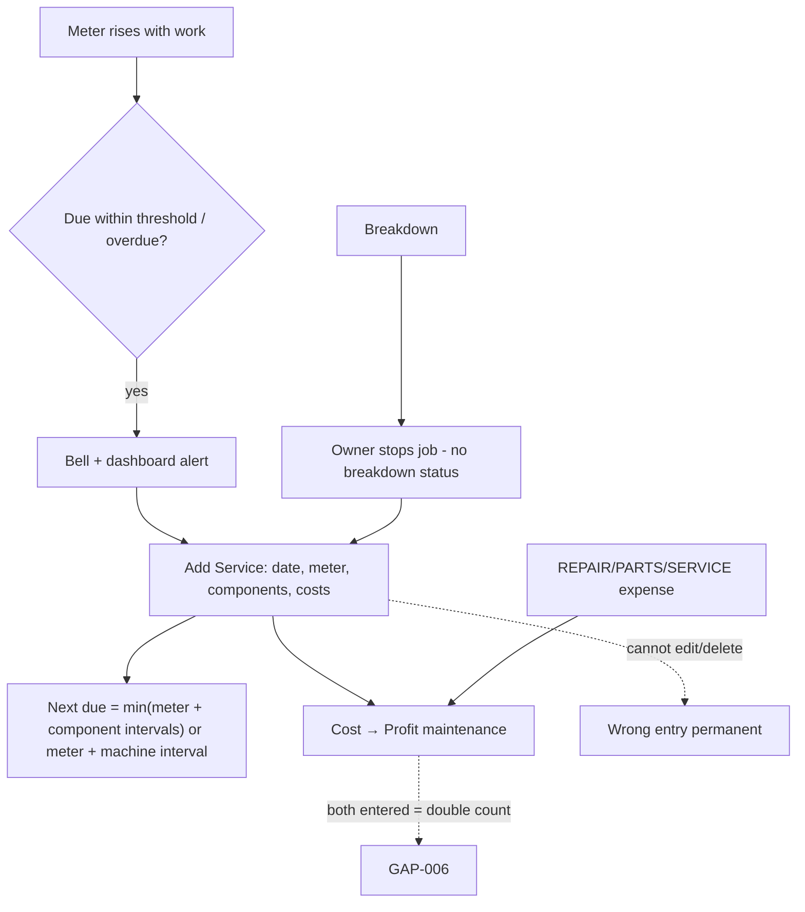
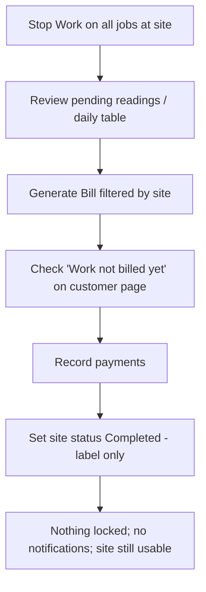

# 04 — End-to-End Business Workflows

These are the business journeys as the product actually supports them, reconstructed from the implementation. Every step maps to a feature ID in 02_MASTER_FEATURE_REGISTER.md. A step the product does **not** support is marked **[MANUAL / OFF-SYSTEM]**.

**Actors**
- **Owner** — the only business login.
- **Operator** — portal login with mobile and PIN.
- **Support** — the platform support console.

---

## Overview: how the pieces fit

---

## Journey 1 — Machine onboarding

| | |
|---|---|
| **Starting condition** | A registered business |
| **Actors** | Owner |
| **Required records** | none |
| **Final outcome** | The machine is ready for work, with a meter, service schedule, operator and site |

**Steps**
1. **Add Machine** (MACH-01). Enter name, number, brand, model, purchase date, **starting hour meter** and optional service interval. This creates the machine with status Idle, current meter = starting meter, placed last in the display order.
2. The service schedule starts automatically: next service = starting meter + interval (machine interval, or the business default of 350 h) (MA-1).
3. **Assign operator** (MACH-08). Any active operator can be chosen; this ends that operator's other machine assignment. The assignment date is today and cannot be changed.
4. **Set current site** (MACH-09, optional). Choose or type a site name; a new site is created automatically.
5. The machine can now be used for **Start Work** (Journey 3).
6. Over time, each job, reading, service and expense is attached to the machine:
   - **Work** tab: current job;
   - **History** tab: jobs;
   - **Service** tab: services and component history.

   Expenses are listed only on the Expenses page; the machine page has no expense view.

**Exceptions**
- The starting meter cannot be corrected after creation.
- There is no owned / rented flag.
- "Under Service" is never set.
- The operator assignment history is not visible.

## Journey 2 — Customer onboarding

1. **Add Customer** (CUST-01): name, mobile, company, address, GSTIN. There is no duplicate check. Customers can also be added inline from Start Work, Direct Bill or operator-job approval.
2. **Create Site** (SITE-01) on Site Analysis:
   - name (unique);
   - type: Customer site (customer required) or Self site;
   - location and status;
   - **Bucket rate and Breaker rate per hour.**

   A site is also auto-created by name when work is started, with **no customer and no rate**.
3. **Commercial arrangement** = the site's hourly rates only (SITE-03). Rates are effective-dated; there is no contract, minimum, or daily/monthly term **[MANUAL / OFF-SYSTEM]**.
4. Machine allocation and work commencement follow Journey 3.

**Exception:** the customer who is billed is chosen per job at Start Work, independently of the site's customer.

## Journey 3 — New excavation assignment (start a job)

**Prerequisites**
- The machine has an assigned operator.
- The customer is not archived.
- No active job, and no in-progress or pending operator job, on the machine.

**Path A: the owner starts the job**

1. Machine page → **Start Work** (WORK-01). The owner enters:
   - customer (pre-filled from the site's customer);
   - site name;
   - start date;
   - opening meter (pre-filled from the machine meter);
   - tool (Bucket / Breaker / Chaining).
2. The app creates an **active job**:
   - the operator is snapshotted from the machine;
   - the machine status becomes **Working**;
   - the machine meter = opening meter (no continuity check).
3. **Rate:** none is stored on the job. The value comes later from the site's rate on each work date (BR-9), or from the bill.

**Path B: the operator starts the job (portal)**

1. **Start Work** (PORT-04): start meter, date, tool, proposed site, optional diesel.
2. The app creates an operator job ("in progress"). The machine immediately becomes **Working** and its meter is set, **but nothing is billable yet**.
3. The operator later **Ends Work** (PORT-05) with the end meter and date, and the job becomes "pending approval".
4. The owner **approves** it (WORK-12):
   - picks or creates the customer, and confirms the site, meters, dates, tool and diesel;
   - the app creates a **completed** job directly, sets the machine **Idle**, sets the meter to the end reading, and sets the machine's site.

   Or the owner **rejects** it with a note; the operator edits and resubmits.

## Journey 4 — A complete working day (owner-started job)

1. A job is active (Journey 3, path A).
2. **Daily reading**, one per job per date (database-enforced):
   - **Owner:** Add Daily Log (WORK-03), with meter start/end *or* clock start/stop and break, optional operator name, diesel litres, tool and notes. It is approved immediately.
   - **Operator:** Submit Reading (PORT-01), with the same fields plus "diesel left in tank". It stays **pending**.
3. **Hours calculation:** OP-1 / OP-2. Must be > 0.
4. **Approval** (WORK-07) of operator readings, from the Approvals page or the machine page. On approval:
   - job hours are re-summed;
   - diesel is added to the job;
   - the tool is updated;
   - the meter moves.

   On rejection nothing changes, and no reason is recorded.
5. **Diesel:**
   - recorded on the reading itself;
   - or, by the operator, as a **Diesel only** entry (PORT-02), which attaches to the active job;
   - no purchase or stock record **[MANUAL / OFF-SYSTEM]**.
6. **Expenses** of the day (repairs, transport, other) are added separately on the Expenses page (EXP-01), per machine. They are **not** linked to the job or the site.
7. **Operational history:** the reading appears in the job's readings, Site Analysis (only if approved), the Dashboard hours (any status) and the customer page.

## Journey 5 — Site operations across multiple days

1. Daily readings accumulate on the job (Journey 4). Job hours = Σ approved readings.
2. **Operator change mid-job:** reassigning the machine's operator does not change the job's operator. Readings by the new operator are credited to the original operator **[limitation]**.
3. **Machine change mid-job:** not possible. Stop the job and start a new one on the other machine (Journey 12 then Journey 3).
4. **Stop Work** (WORK-02): end date, end meter (must be > the job's start meter), optional final diesel and tank level. The job becomes **Completed**, the machine **Idle**, and the meter = end. Pending readings stay pending and can still be approved later.
5. **Site history:** Site Analysis → site detail (RPT-02). It shows:
   - totals, with work-type split, value and received/pending;
   - diesel averages;
   - per-machine summary;
   - a daily machine reading table, for any date range and machine.
6. **Final site totals:** Site Analysis "Total revenue" = work value. Billed work is at its bill share; unbilled work is at the site's rates on each work date. Direct and Summary bills are not reflected (see GAP-001).

## Journey 6 — Diesel and operational costs

1. **Fuel bought:** **[MANUAL / OFF-SYSTEM]** as a purchase. The owner may record a **DIESEL expense** (amount, machine, date, notes) (EXP-01).
2. **Fuel put in a machine:** litres on a reading, a diesel-only entry, a stop or an operator job (FU-1).
3. **Fuel left in tank:** "diesel left in tank" on operator readings and stop.
4. **Consumption and averages:** Site Analysis (FU-2 to FU-5); the Diesel Checker calculator (FU-6, not saved).
5. **Fuel cost in profit:** per machine, the DIESEL expenses in the period, or else litres × the Settings diesel price (FU-7).
6. **Customer-supplied diesel:** deducted on the customer's bill as a "diesel advance" (FU-8).
7. **Operational reporting:** the Profit Overview "Diesel" line and its per-machine breakdown in the Detail view.

## Journey 7 — Operator settlement

1. **Register the operator** (OPS-01) with a monthly salary and joining date. An active working period starts on the joining date. Alternatively: self-signup, then the owner approves with the 6-digit code (OPS-05/06). That path starts with salary ₹0.
2. **Work:** the operator works on the assigned machine. Work done does **not** affect salary.
3. **Attendance:** not recorded. Absence = **Add Leave**, unpaid (OPS-09).
4. **Salary accrues daily** (SA-2). Views: the Overview tab (since joining), the Salary tab (month by month, a different formula, GAP-005) and the Sessions tab.
5. **Advances and deductions:** Money tab → Add transaction (OPS-10), choosing a category and "deduct from salary". It reduces the amount owed.
6. **Bonus:** a transaction with effect "Bonus / incentive". It increases the amount owed.
7. **Payment:** a transaction with effect "Salary payment", of any amount (partial allowed).
8. **Operator balance:** Remaining = accrued + bonus − deductions − paid (SA-3 / SA-4). Shown on the operator card and as Dashboard "Salary Due".
9. **Break and return:** Start New Session (OPS-07). The old session closes, the gap is recorded as leave, and a positive balance is carried forward or kept separate.

## Journey 8 — Customer invoicing

1. **Completed work:** jobs in status Completed, not yet on a normal bill.
2. **Choose the bill type** on the Bills page:
   - **Generate Bill (normal)** (BILL-01):
     1. Pick the customer, plus optional site, machine and dates.
     2. All eligible completed jobs are listed and pre-ticked; untick any.
     3. Enter **one rate per hour** (pre-filled with the site's current rate for the main tool), optional tool and site label, bill date, transport / fuel / extra charges, discount, customer-supplied diesel (litres auto-summed from the jobs; enter the price), Non-GST or GST with rate and buyer GSTIN, bank account, and whether to show the customer phone.
     4. The bill is created; each job is linked and can never be billed again on a normal bill.
   - **Summary bill** (BILL-03): type any lines (machine, site, dates, hours, rate), with quick-fill per day or per machine. **Not linked to jobs.**
   - **Direct bill** (BILL-02): one machine and a period. Bucket and Breaker hours are suggested from recorded unbilled hours, with rates from the customer's site; add transport and diesel. **Not linked to jobs.**
3. **Calculation:** BI-1 to BI-7.
4. **Numbering:** Non-GST is automatic (NG-0001…). GST bills need a typed number.
5. **Letterhead:** business details, logos, signature and bank details are copied onto the bill.
6. **Finalisation:** **none.** The bill is immediately "Unpaid", and stays editable and deletable forever.
7. **Outputs:** print, PDF and WhatsApp share, per-bill Excel, the bills register Excel. Template: Standard or Daily Summary (business-wide).

## Journey 9 — Customer payment

1. Bill detail → **Give Money** (PAY-01), shown while something is pending. Enter amount (default = the full pending amount), date, method (free text) and notes.
2. Check: amount ≤ the remaining balance.
3. The payment is saved. The bill's paid amount = Σ payments, and its status becomes Unpaid, Partial or Paid (BI-8).
4. **Further payments:** repeat. Partial payments are unlimited.
5. **Corrections:** edit or delete the payment (PAY-02/03), which recalculates the status.
6. **Outstanding:**
   - bill pending = total − paid;
   - customer Pending = bill balances + unbilled work value (RC-2);
   - Dashboard Pending = all bills + unbilled work − all payments (RC-5).
7. **Not available:** advance, overpayment, one receipt across several bills, receipt document **[MANUAL / OFF-SYSTEM]**.

## Journey 10 — Maintenance event

1. **Machine activity** moves the hour meter, and the service-due countdown runs (MA-1). Alerts appear on the bell and dashboard when due within the threshold (default 50 h) or overdue. Component alerts appear within 15 h.
2. **Breakdown:** no breakdown action exists. The owner stops the job (Stop Work) **[workaround]**.
3. **Service record** (SVC-01), from the Service tab → Add Service:
   - date, meter at service (raises the machine meter if higher);
   - components ticked, each with an action (Serviced, Replaced, Repaired…), cost, brand and note.

   Items marked "Not done" last time are pre-ticked.
4. **Repair expense:** either as line costs on the service record, **or** as a REPAIR / PARTS / SERVICE expense. **Do not do both: it is counted twice in profit** (GAP-006).
5. **Completion:** the record has no open/closed state; it is complete on save. The next due point is recalculated (MA-2).
6. **Availability:** unchanged throughout. The machine was never marked unavailable.

## Journey 11 — Expense-to-profitability

1. **Machine revenue:** the value of approved work (bill share, or site rate on the work date), plus bill charges minus discount, plus Summary lines and Direct subtotals (R-PROFIT).
2. **Operational expenses:** Transport / Other expenses.
3. **Maintenance:** service-record cost plus Repair / Service / Parts / Tyres expenses.
4. **Operator costs:** the calendar-month salary plus bonus of active operators, prorated over the range up to today. *Not* advances or payments.
5. **Diesel:** FU-7.
6. **Final report:** Dashboard → Business Profit Overview (RPT-06): Revenue, Expenses (four lines), Actual Profit, Margin %, plus a Detail view of every input.
7. **Per machine:** Machine Performance shows **revenue and hours only**. There is no cost or profit per machine, site or customer.

## Journey 12 — Closing a site or assignment

1. **Completion of work:** Stop Work on each machine's job.
2. **Final working-hour reconciliation:** review Site Analysis → Daily Machine Reading (flags end < start and negative diesel) and the Approvals page for pending readings. **There is no closing checklist.**
3. **Billing reconciliation:** Generate Bill for the customer, filtered to the site. Customer page → "Work not billed yet — site wise" shows what remains.
4. **Payments:** record them as received (Journey 9).
5. **Expenses:** nothing to allocate; there are no site expenses.
6. **Closure:**
   - change the site status to Completed (Site detail → Edit), or choose it when moving the machine off the site (Site card);
   - optionally end the operator assignment.
7. **Effect of closure:** **none.** Work can still be started, readings added and bills raised at a Completed site. Nothing is triggered.

