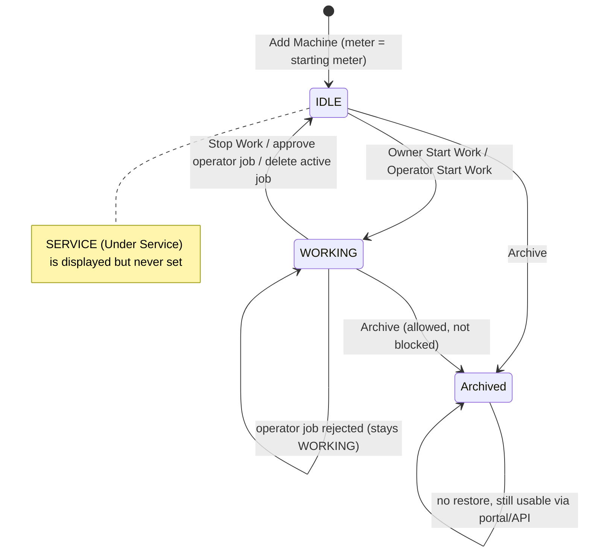
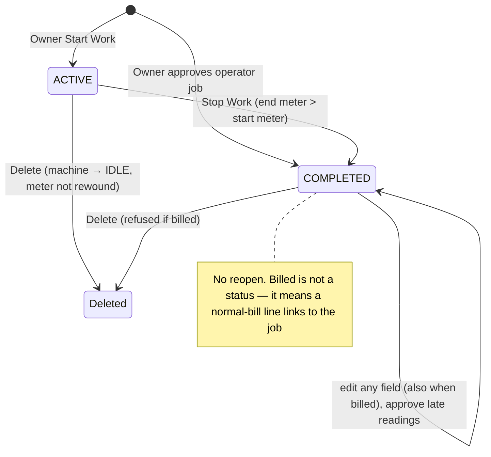
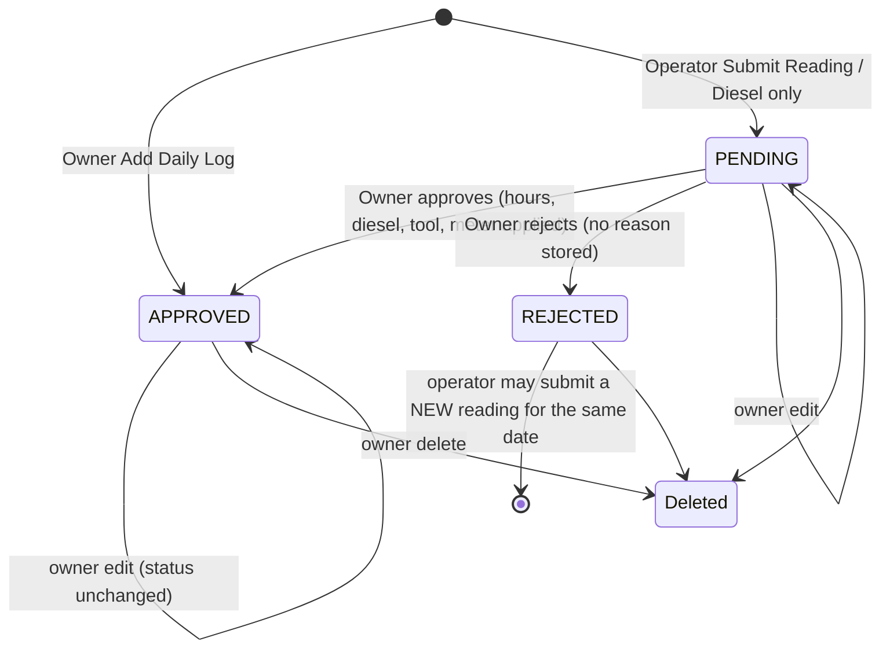
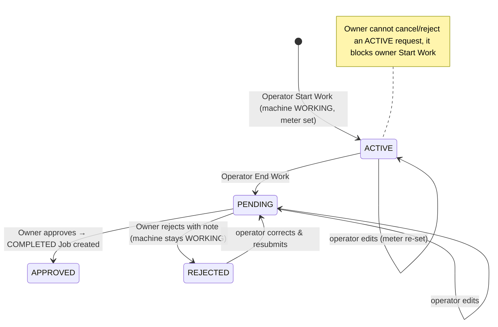
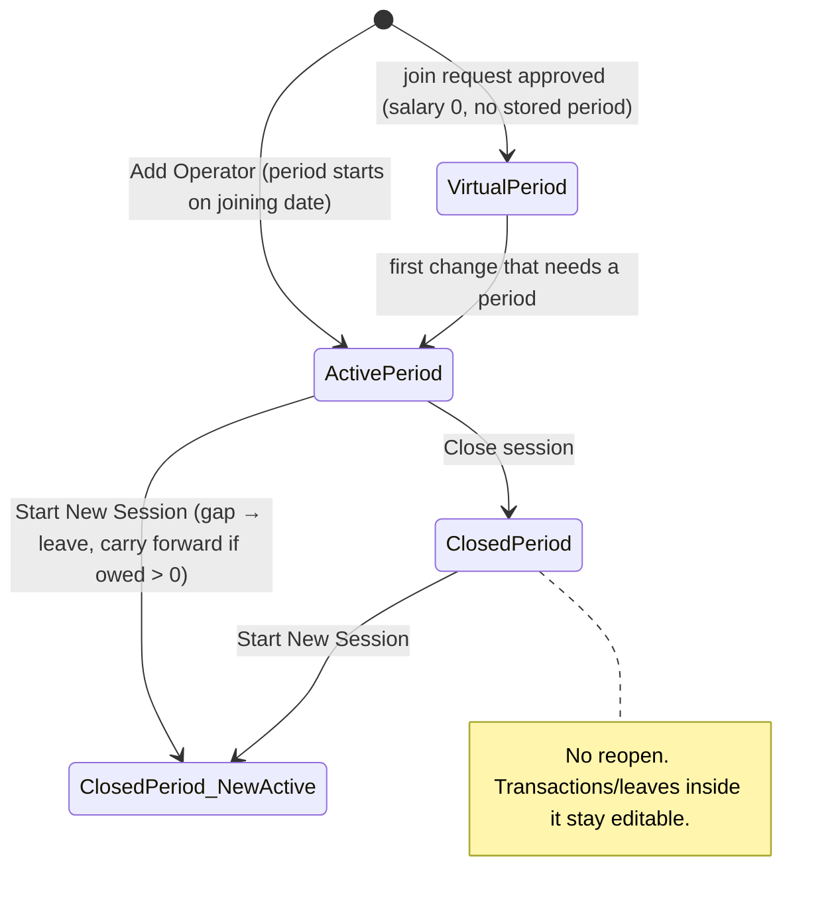
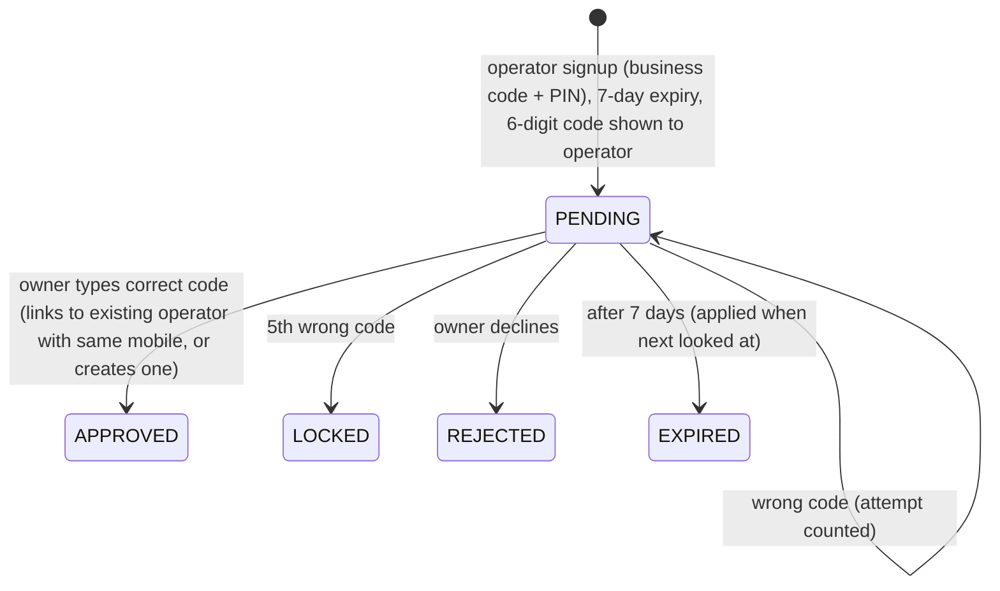

# 06 — Record Lifecycle and Statuses

This document shows every major business record: how it is created, which statuses it moves through, how it ends, and whether it can be corrected.

Statuses are listed only where the product actually stores them. Evidence is grade **B** (traced through the code) unless marked otherwise. The detail is in the deep dives.

## Summary table

| Record (business name) | Stored statuses | Created by | Can be edited? | Can be deleted? | Ends by |
|---|---|---|---|---|---|
| Business | active, frozen | Register | Profile in Settings | No; support "clear data" wipes commercial records only | — |
| Machine (Excavator) | IDLE, WORKING (SERVICE exists but is never set); archived flag | Add Machine | Yes (not meters/status) | No; archive only, no restore | Archive |
| Operator–machine assignment | ACTIVE, ENDED | Assign operator | No | No | Reassign / End / assigning the operator elsewhere |
| Customer | archived flag | Add Customer / inline | Yes | No; archive only, no restore | Archive |
| Site | ACTIVE (Ongoing), PARTIAL (Partially Completed), COMPLETED, ON_HOLD (Deactive) | Create Site / auto by name | Yes | No | Status label only |
| Site rate history | — | Create site with rates / change rates | No | No | Superseded by a newer row |
| Job (Work Session) | ACTIVE, COMPLETED | Owner Start Work / approval of an operator job | Yes, any time, including billed | Yes if not billed | Stop Work / created completed |
| Daily reading (Daily Work Log) | APPROVED, PENDING, REJECTED; kind WORK / DIESEL_ONLY; source ADMIN / OPERATOR | Owner Add Daily Log / operator Submit Reading / Diesel only | Owner yes (any status); operator no | Owner yes | — |
| Operator job (Work Request) | ACTIVE, PENDING, APPROVED, REJECTED | Operator Start Work | Operator while ACTIVE or PENDING | No | Approved → becomes a Job |
| Join request | PENDING, APPROVED, REJECTED, EXPIRED, LOCKED | Operator self-signup | No | No | Decision / 7-day expiry / 5 wrong codes |
| Operator | archived flag; portal enabled / disabled | Add Operator / join approval | Yes | No; archive only ("Delete" in the UI), no restore | Archive |
| Working period (Session) | ACTIVE, CLOSED | Operator creation / Start New Session | Dates and notes (API only); salary via Edit Operator for the active period only | No | Close / Start New Session |
| Leave | type PAID / UNPAID | Add Leave / automatic gap on new session | No | Yes | — |
| Operator money transaction | — (effect: advance, business expense, salary payment, bonus, other) | Add transaction | Yes, any time | Yes (hard) | — |
| Service record | — | Add Service | **No** | **No** | — |
| Expense | — | Add expense | **No** | Yes (hard) | — |
| Bill | UNPAID, PARTIAL, PAID; isDirect; type GST / NON_GST | Generate / Summary / Direct bill | **Yes, every field, any time** | Yes (hard, with its payments) | Never "finalised" |
| Payment | — | Give Money | Yes | Yes (hard) | — |
| Bank account | archived flag; default-for-GST / Non-GST flags | Settings | API only (no screen) | Archive | Archive |
| Audit entry | — | Automatically, on every financial change | No (append-only, database-enforced) | No | — |

---

## Machine



## Job (Work Session)



- **Created:** the operator is copied from the machine's assigned operator. The machine becomes WORKING.
- **Updated:** totals are re-summed whenever its readings change. An owner edit can change customer, operator, site, dates, meters and diesel, even after billing.
- **Completed:** readings can no longer be added, but pending ones can still be approved.
- **Deleted:** together with all its readings. A job created from an operator request leaves that request APPROVED, with no job attached.

## Daily reading



## Operator job (Work Request)



## Bill and payment

```mermaid
stateDiagram-v2
  [*] --> UNPAID: Generate / Summary / Direct bill
  UNPAID --> PARTIAL: payment < balance
  UNPAID --> PAID: payment = balance
  PARTIAL --> PAID
  PAID --> PARTIAL: payment edited down / deleted / bill total raised
  PARTIAL --> UNPAID: all payments deleted
  UNPAID --> Deleted: Delete bill
  PARTIAL --> Deleted: Delete bill (payments deleted)
  PAID --> Deleted: Delete bill (payments deleted)
  note right of PAID: Any state: full edit allowed (total ≥ paid), letterhead re-stamped. No DRAFT/ISSUED/CANCELLED/VOID/OVERDUE
```

- **Deleting a normal bill** makes its jobs billable again.
- **Bill numbers** of deleted bills are never reused.

## Operator, working period and leave



| Operator portal access | Transitions |
|---|---|
| Disabled (default) | → Enabled with PIN (owner sets PIN) / → "awaiting activation" (enabled, no PIN) |
| Enabled | → PIN reset / → Disabled (all portal sessions ended) |
| Any | Archiving the operator blocks login |

## Join request



## Site

| From | To | Trigger |
|---|---|---|
| — | ACTIVE | Create Site (or auto-created by name) |
| any | any | Owner edits the site status |
| any (old site) | chosen status | Owner moves a machine off the site and picks the old site's status |

No status blocks work or billing, and no status change triggers anything. There is no site delete or archive.

## Assignment (operator ↔ machine)

| From | To | Trigger |
|---|---|---|
| — | ACTIVE (start = now) | Assign operator to machine |
| ACTIVE | ENDED (end = now) | Another operator assigned to the same machine; the same operator assigned to another machine; "End" |
| ACTIVE | stays ACTIVE | Operator archived (not ended) |

## Historical-impact matrix (what changes in the past when you edit)

| You change… | Old bills | Old jobs and readings | Reports for past periods |
|---|---|---|---|
| Customer name, address, phone | **Change** (read live) | Show the new name | Show the new name |
| Customer GSTIN | Unchanged (buyer GSTIN frozen on the bill) | — | — |
| Machine name or number | **Change** (read live) | Show the new name | Show the new name |
| Business profile, logo, bank | Unchanged until that bill is edited, which re-stamps it | — | — |
| Bill template | **All bills change layout** | — | — |
| Site name | Unchanged (site name frozen on bill lines) | Show the new name | Show the new name |
| Site rate (new effective date) | Unchanged | — | Unbilled work valued at the new rate from that date; work before the first rate also uses the first rate |
| Job or reading hours, diesel | Unchanged | Changed | Hours change; billed revenue does not |
| Expense, service record | — | — | Profit restated (service records cannot be changed) |
| Operator salary (Edit Operator) | — | — | Whole current session revalued; profit salary cost changes |
| Operator archived | — | — | Removed from salary due and from past months' salary cost |
| Diesel price in Settings | — | — | Diesel cost re-calculated for every period without DIESEL expenses |
