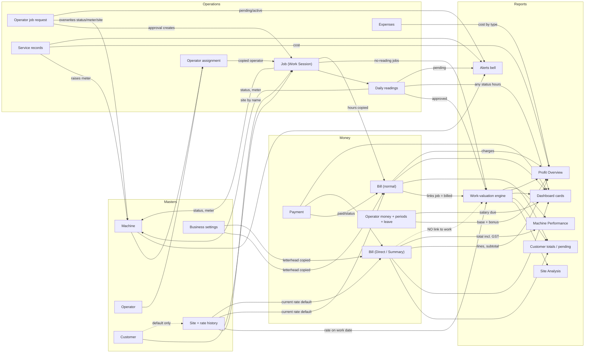

# 07 — Cross-Module Data Flow and Relationships

This document shows how information actually travels between modules. Every relationship below was checked in the code. Two modules sharing a "machine" or "site" field was **not** taken as proof that they are connected.

**Propagation types**
- **Live**: the receiving screen recalculates from the source every time it is opened.
- **Copied**: a value is copied when the record is created and does not follow later changes.
- **Write-through**: the source action updates the receiver in the same step.
- **None**: there is no connection.

## Relationship table

| # | Source feature | Information generated | Receiving feature | What happens there | Propagation | Business consequence | Ev. |
|---|---|---|---|---|---|---|---|
| 1 | Machine (Add or Edit) | Machine identity, starting meter, service interval | Start Work, pickers, bills, service status | Machine selectable; starting meter anchors service-due | Live (name/number on bills is live) | Renaming a machine renames it on old bills | B |
| 2 | Operator assignment | Machine's current operator | Start Work (owner) | Required. Copied onto the job as its operator | **Copied** at job start | Reassigning mid-job does not change the job's operator | B |
| 3 | Operator assignment | Machine for the operator | Operator portal | Portal shows only the assigned machine; operator can submit only for it | Live | — | B |
| 4 | Customer | Customer identity | Start Work, bills, operator-job approval | Required on every job and bill; archived customers refused for new ones | Live (name/address/mobile on bills are live) | Editing a customer changes old bills | B |
| 5 | Customer → Site | Site's owning customer | Start Work customer default; Site Analysis label | Pre-fills the customer only; the job keeps its own customer | One-way, optional | Job customer and site customer can differ | B |
| 6 | Site rates (rate history) | Bucket and Breaker rate by effective date | Site Analysis, customer unbilled value, Dashboard totals, Profit revenue, Direct-bill hours helper | Unbilled work valued at the rate on the work date | Live | Rate changes revalue unbilled work only | B |
| 7 | Site current rate | Current Bucket/Breaker rate | Generate Bill, Direct, Summary rate default | Pre-fills the bill rate (today's rate, not the work-date rate) | Copied into the bill | Bill may not match the Site Analysis value | B |
| 8 | Job start/stop, readings | Machine status and hour meter | Machine list, service status, alerts | Status WORKING/IDLE; meter set or raised | Write-through | Wrong meter entries change service alerts | B |
| 9 | Approved readings | Job total hours | Normal bill line hours | Bill takes `round2(job hours)` at billing time | Copied into the bill | Later reading changes do not reach the bill | B |
| 10 | Approved readings, and jobs with no readings | Work entries (hours, tool, diesel, date) | Site Analysis, Customer unbilled, Dashboard Total/Pending, Profit revenue, Machine Performance, Direct-bill hours helper | The single valuation engine | Live | — | B |
| 11 | All readings (any status) | Hours | Dashboard Hours card and 6-month hours chart | Counted even if pending or rejected | Live | Dashboard hours ≠ Site Analysis hours | B |
| 12 | Operator readings / jobs | Pending items | Approvals page, alerts bell | Await owner decision | Live | Nothing moves until approved | B |
| 13 | Operator-job approval | New completed job | Machine (IDLE, meter = end, site = approved site) | Unconditional overwrite | Write-through | Can rewind the meter or mark the machine idle during a newer job | B |
| 14 | Machine Site card move | Old site status | Site | Old site's status set | Write-through (optional) | Only automatic status change in the product | B |
| 15 | Normal bill | Bill line linked to job | Work-entry engine ("billed" flag), Generate Bill eligibility | Job excluded from future bills; valued at its bill share | Write-through | Prevents double billing on normal bills | B |
| 16 | **Direct / Summary bill** | Bill without job links | Work-entry engine | **No link**: covered hours stay "unbilled" | **None** | Double invoicing and double counting (GAP-001) | B |
| 17 | Bill | Total, charges, GST, diesel advance | Dashboard Revenue, Total, Pending; Customer pages; Payment Collection; Top Customers; Profit (charges, Summary lines, Direct subtotal); Machine Performance (Direct total) | Summed | Live | — | B |
| 18 | Business settings (profile, logos, bank) | Letterhead | Bill | Copied when the bill is created and re-copied on every edit | Copied | Settings changes reach old bills only when they are edited | B |
| 19 | Bill template setting | Layout choice | Every bill view and print | Applied to all bills | Live | Old bills change layout | B |
| 20 | Payment | Amount, date | Bill (paid amount, status) | Recalculated in the same step | Write-through | — | B |
| 21 | Payment | Amount, date | Dashboard Amount Received (by payment date), Pending; Customer pending; Site received (pro-rata) | Summed | Live | Deleting a bill deletes its payments from every total | B |
| 22 | Service record | Meter at service | Machine hour meter | Raised if higher | Write-through | Wrong entry permanent | B |
| 23 | Service record | Next-due point, component history | Service status, alerts, component alerts | — | Live | — | B |
| 24 | Service record | Cost | Profit Maintenance | Summed by service date | Live | Double counting with expenses (GAP-006) | B |
| 25 | Expense | Amount by type and machine | Profit (Maintenance / Diesel / Other) | Summed by expense date. A DIESEL expense replaces litres × price for that machine | Live | — | B |
| 26 | Expense | — | Machine page, Site Analysis, Machine Performance | **Not shown** | None | No machine- or site-wise cost view | B |
| 27 | Diesel litres on work records | Litres | Profit Diesel (× Settings price) | Costed when the machine has no DIESEL expense in the period | Live | — | B |
| 28 | Diesel litres on jobs | Litres | Normal bill diesel advance | Litres summed in the browser; price typed | Copied | — | B |
| 29 | Settings diesel price | ₹/litre | Profit only | — | Live | Not used on bills | B |
| 30 | Operator salary / periods / leave / transactions | Accrued salary, bonus | Profit Operator Salary, Dashboard Salary Due | Calendar-month base + bonus; due = per formula | Live | Advances, payments and expenses do not reach profit | B |
| 31 | Readings / jobs | Hours by operator | Operators ranking | 45-day hours | Live | Not linked to salary | B |
| 32 | Work done (hours) | — | Salary | **No connection** | None | Salary is time-based only | B |
| 33 | Operator money "business expense" | — | Profit / Expenses | **No connection** | None | Such money is invisible in profit | B |
| 34 | Site status | — | Start Work, readings, bills | **No connection** (label only) | None | Closed sites stay usable | B |
| 35 | Machine archive | — | Operator portal, Start Work, Service, Expenses (API) | **Not enforced** | None | Archived machines can keep receiving records | B |
| 36 | Support console limits | Max operators, max bills per day | Add Operator, all bill types | Enforced | Live | — | B |
| 37 | Support freeze | Frozen flag | All business and operator actions | Blocked with a notice | Live | — | B |
| 38 | Every financial write | Audit entry | Support/back-office only | Append-only | Write-through | Owner cannot view history | B |

## Relationship map (verified connections only)

## Dependency classification

| Type | Relationships |
|---|---|
| **Strong (required)** | Job → machine, customer, site, operator. Bill → customer. Payment → bill. Reading → job. Service record, expense → machine. Working period, transaction, leave → operator |
| **Optional** | Site → customer. Bill → bank account. Bill line → job (normal bills only). Machine → current site. Machine → current operator |
| **Manual links** | Customer chosen per job (independent of site). Site chosen by typed name. Bill rate typed / pre-filled. Diesel price per bill typed. Site status changed by hand |
| **One-way flows** | Readings → machine meter (never the reverse). Job hours → bill (copied once). Settings → bill letterhead (copied). Operator job → machine (overwrite) |
| **Disconnected** | Direct/Summary bills ↔ work. Expenses ↔ jobs/sites/service records. Salary ↔ hours/attendance. Operator "business expense" money ↔ profit. Site status ↔ anything. Diesel expense ↔ litres. Archive flags ↔ server-side checks for machines and operators |
| **Duplicate sources of the same information** | Maintenance cost (service-record cost **and** REPAIR/SERVICE/PARTS/TYRES expenses). Billed hours (normal-bill lines **and** Direct/Summary typed hours). Machine location (current site **and** active job's site). Operator on a job (job operator **and** machine's current operator). Job diesel total (sum of readings **and** typed overwrite on job edit). Salary owed (three formulas) |
